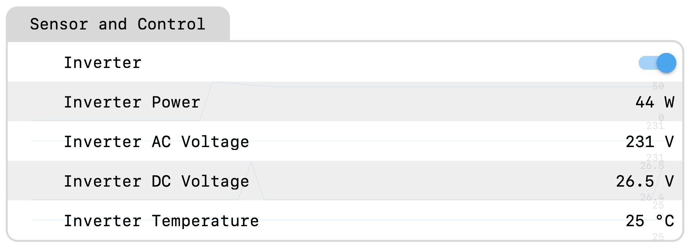

# ESPHome - FCHAO off-grid Inverter

 

ESPHome integration to monitor and turn ON//OFF a FCHAO inverter via RS485/RJ-45 port.

This component can either replace the native external display or operate in parallel with it on the same RS485 bus. Refer to the `send_request` configuration setting for additional information.

Refer to the [Wiring](#wiring) section.

<p align="center">
  
</p>

To use this integration, add the configuration below to your ESPHome YAML file.

Choose your communication GPIO pins and specify them in the YAML configuration.
- `tx_pin` under `uart`
- `rx_pin` under `uart`
- `flow_control_pin` under `fchao_inverter`

`flow_control_pin` is optional and only required if your MAX485 module exposes DE/RE pins (i.e., it doesn't automatically manage TX/RX).

If you are using the ON/OFF switch, remember to specify your control `pin` under `switch` as well.

```yaml
external_components:
  - source:
      type: git
      url: https://github.com/christian-dascoli00/ESPHome-FCHAO-inverter.git
      ref: main
    components: [fchao_inverter]

uart:
  tx_pin: GPIO25    # Your choice
  rx_pin: GPIO26    # Your choice
  baud_rate: 9600


fchao_inverter:
  - id: inverter1
    update_interval: 1s         # Your choice
    flow_control_pin: GPIO27    # Your choice

sensor:
  - platform: fchao_inverter
    ac_voltage:
      name: "Inverter AC Voltage"
    power:
      name: "Inverter Power"
    dc_voltage:
      name: "Inverter DC Voltage"
    temperature:
      name: "Inverter Temperature"

switch:
  - platform: gpio
    pin: GPIO13     # Your choice
    name: "Inverter"
```

See [`inverter.yaml`](./inverter.yaml) for a complete configuration example.

`fchao_inverter:`
- `id` (Required, ID): ID used to reference this component.
- `uart_id` (Optional, ID): ID of the `uart` bus this component is attached to. Only needed if you have multiple UART buses configured.
- `update_interval` (Optional, Time): Interval between status requests sent to the inverter. Defaults to `5s`. In practice, this controls how often sensor values are updated when `send_request` is enabled (`true`). It has no effect on the passive listening done in `loop()`.
- `flow_control_pin` (Optional, Pin): GPIO pin connected to the DE/RE pins of the MAX485 module (tied together), used to switch the transceiver between transmit and receive mode. Not needed if your MAX485 module handles flow control automatically (no DE/RE pins exposed).
- `rx_timeout` (Optional, Time): Maximum time allowed between two consecutive bytes of an incoming frame before the partially received buffer is discarded. Defaults to `200ms`.
- `data_timeout` (Optional, Time): Maximum time allowed without receiving a valid, complete frame before all sensors are published as `NaN`. Defaults to `5s`.
- `send_request` (Optional, boolean): Whether to actively send the status request packet to the inverter on every `update_interval`. Set to `false` to passively listen to the bus only (e.g. when sharing the bus with the inverter's native external display, which already sends the request). Set to `true` if this integration is used as replacement for the native external display. If set to `false`, `update_interval` has no effect. Defaults to `true`.

`sensor:`
- `platform`: `fchao_inverter`
- `fchao_inverter_id` (Optional, ID): ID of the `fchao_inverter` component to use, if you have multiple instances configured. Defaults to the only configured instance.
- `ac_voltage` (Optional): AC output voltage sensor, in Volts.
  - All other options from [Sensor](https://esphome.io/components/sensor/index.html#config-sensor).
- `power` (Optional): Output power sensor, in Watts.
  - All other options from [Sensor](https://esphome.io/components/sensor/index.html#config-sensor).
- `dc_voltage` (Optional): DC/battery voltage sensor, in Volts.
  - All other options from [Sensor](https://esphome.io/components/sensor/index.html#config-sensor).
- `temperature` (Optional): Inverter internal temperature sensor, in °C.
  - All other options from [Sensor](https://esphome.io/components/sensor/index.html#config-sensor).

If you are using the GPIO switch to control the inverter, consider using it to start or stop UART communication too. You can also use it to set sensor values to `NaN` when the switch is turned off. For example:

```yaml
esphome:
  name: inverter
  on_boot:
    - priority: -100
      then:
        - lambda: |-
            id(inverter1).stop_poller();

switch:
  - platform: gpio
    pin: GPIO13
    name: "Inverter"
    on_turn_on:
      - lambda: |-
          id(inverter1).start_poller();
    on_turn_off:
      - lambda: |-
          id(inverter1).stop_poller();
          id(inverter1).publish_nan();
```

Tested on:

- 3000W 24V model (by the author)
- 2500W 24V model (by [@subivoodoo](https://github.com/subivoodoo))

This integration emulates the request made by the external display, which always sends the same packet. The request packet could vary depending on the inverter variant.

The ON/OFF switch requires a circuit with a transistor or a relay. However, the user can use the integration ignoring the switch, switching manually ON/OFF via the hardware button in the inverter case.

This project is licensed under the MIT License. This project is provided as-is, with no guarantees of any kind. Use of this repository and its contents is entirely at your own risk.

## Wiring

The inverter RS485 port consists of a communication part (RS485) and a pulled up dry contact to switch ON/OFF the inverter.

A MAX485 module and a level shifter are required (level shifter may be avoided, see [comment below](#comment)).

Inverter RS485/RJ-45 port pins:
| RJ45 pin | function |
|----------|-----------|
| 1 | GND | 
| 2 | GND | 
| 3 | Dry contact - ON/OFF | 
| 4 | NA | 
| 5 | Dry contact - ON/OFF | 
| 6 | NA |
| 7 | RS485 A | 
| 8 | RS485 B | 

NA: Not used by the integration (probably a power supply for the native external display)

```
    Inverter port
       ┌─────┐
     ┌─┘     └─┐
 ┌───┘         └───┐ 
 │                 │ 
 │ 1 2 3 4 5 6 7 8 │ 
 │ | | | | | | | | │ 
 └─────────────────┘
```

### Sensor monitor

The RS485 A and RS485 B pins should be connect to a MAX485 module converter, and then to level shifter, connected to RX/TX ESP32 pins.

Both MAX485 variants, with and without RE/DE pins, have been tested and work.
The variant with DE/RE pins is generally more reliable, though the simpler variant
(without these pins) also works. If using a module with DE/RE pins, tie these two
pins together and connect them through the level shifter to the chosen ESP32
`inverter_flow_pin`.

The level shifter is necessary (see [comment below](#comment) for a workaround) because MAX485 is 5V rated, while ESP32 is 3.3V rated. If the inverter and the ESP32 has common ground (example: battery supplies power to the inverter and to the ESP32 through a buck converter), the inverter GND communication side connection is not necessary, however the remaining GND connections in the schema below are required.

```
                                               ^
┌──────────┐                 ┌──────────┐      |      ┌─────────┐                ┌─────────┐ 
│          │ <-- RS485 A --> │          │ <-- 5V ---> │         │ <-- 3.3V ----> │         │
│ INVERTER │ <-- RS485 B --> │  MAX485  │ <-- TX ---> │  Level  │ <--- TX -----> │  ESP32  │
│          │                 │          │ <-- RX ---> │ shifter │ <--- RX -----> │         │
│          │                 │          │ <- DE/RE -> │         │ <- flow pin -> │         │
│          │ <---- GND ----> │          │ <-- GND --> │         │ <-- GND -----> │         │
└──────────┘        │        └──────────┘      │      └─────────┘      │         └─────────┘
                    └──────────────────────────┴───────────────────────┘
```

Using a MAX485 module powered at 3.3V to avoid the level shifter has been found to
cause invalid/corrupted packets. A MAX3485 module, which is rated for 3.3V operation,
should work without a level shifter, but this has not been verified by the author.

<a id="comment"></a>[@subivoodoo](https://github.com/subivoodoo) reported that MAX485 (with `DE / RE`) can be used without a level shifter: `TX` and `contro flow pin` can be driven directly by ESP32 GPIOs, while the `RX` can be connected to the ESP32 through a voltage divider `5V -> 3.3V`, with the MAX485 powered directly from 5V.

### Switch ON/OFF control

Use a NPN transistor in order to control the pulled-up dry contact with an ESP32 GPIO pin. Alternatively, you can simply use a relay that shorts the dry contact to GND tu turn the inverter ON. Both solutions are compatible with the YAML configuration shown above. When using a relay, you may need to set `inverted: true`, depending on how the relay operates.

The transistor-based wiring is illustrated below.

In the 24V inverter variant the dry contact is pulled up at 24V. Probably the pull up voltage always corresponds to the DC inverter input. Choose a proper transistor, rated for this collector (C) voltage. The BC547B has been confirmed to work.

```
┌──────────┐                     ┌─────────┐                         ┌─────────┐ 
│          │ Dry contact <---> C │         │ B <- 10 kOhm ----> GPIO │         │
│ INVERTER │                     │   NPN   │                |        │  ESP32  │
│          │                     │         │             10 kOhm     │         │ 
│          │                     │         │                |        │         │ 
│          │ GND <-----------> E │         │ E <---------------> GND │         │ 
└──────────┘                     └─────────┘                         └─────────┘
```

## Docs

Status request packet

```0xAE 0x01 0x01 0x03 0x05 0xEE```

Status response packet

```
0xAE 0x01 0x12 0x83 | 0x02 0x31 | 0x34 0x37 | 0x02 0x54 |  0x00 0x27  | 0x00 |  0x42 |  0x07 | 0x50 | 0xEE
───────────────────  ─────────── ─────────── ───────────  ───────────  ──────  ──────  ────── ────── ─────
                    |   AC      |           |    DC     |             |      |       | BATT. |  ?   | END
       HEADER       | VOLTAGE   |  POWER    |  VOLTAGE  | TEMPERATURE |      | FAULT | GAUGE |      |  
                    | (231V)    | (3437W)   |  (25.4V)  |   (27°C)    |      |       |       |      |         
```

FAULT: `0x04` overload

BATTERY GAUGE: to show bars in the battery icon (depending on DC voltage)
